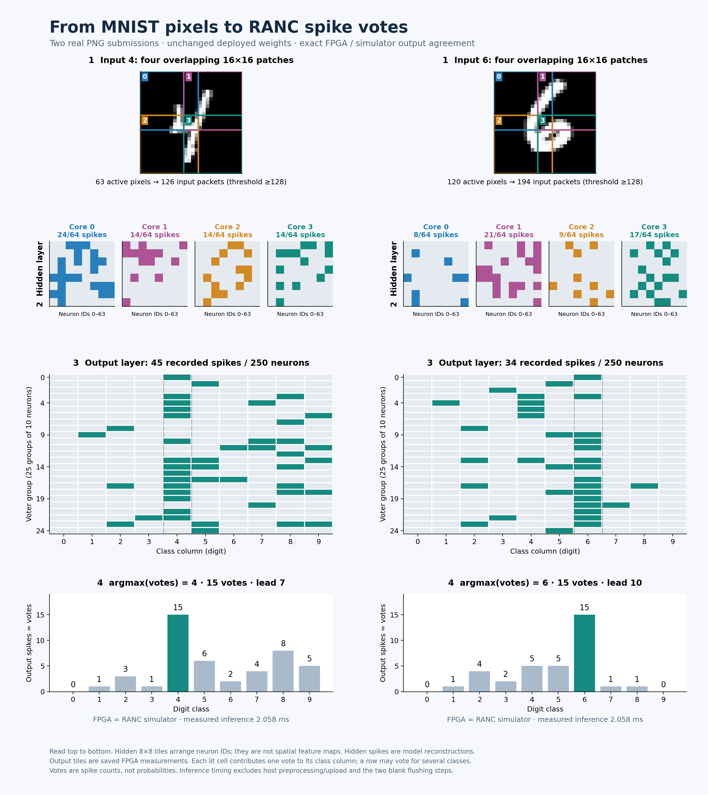

# AUP RANC MNIST classifier — Vivado / Vitis 2024.2

This branch, **`AUP-ZU3-mnist-classifier`**, contains a working MNIST classifier
for the **AUP-ZU3 (`xczu3eg-sfvc784-2-e`)**. One A53 bare-metal application sends
image spikes through AXI DMA to RANC in programmable logic, reads the output
spikes and decodes a digit class. It stays resident for repeated tests.

The shipped XSA and ELF are the pair physically tested on the AUP: all 10,000
test images matched the RANC simulator, with **9,526 correct (95.26%)**. New PNG
images can also be submitted without rebuilding the FPGA or application.

**PetaLinux and SD-card boot support are not included yet. They can be added
later.** This flow uses JTAG, DDR and UART; no operating system, SD card,
TensorFlow installation or training is required on the board.

## Start here

After this branch is published, obtain a clean checkout with:

```bash
git clone --branch AUP-ZU3-mnist-classifier --single-branch \
  https://github.com/UA-RCL/Hardware-Images.git AUP-ZU3-mnist-classifier
cd AUP-ZU3-mnist-classifier
```

| What you want to do | Start with |
| --- | --- |
| Understand why the example 4 and 6 win | [Visual explanation](#see-how-the-classifier-makes-its-decision) |
| Run the design on AUP now | [One-time JTAG setup](#run-on-the-aup-board), using prebuilt files |
| Test a new PNG | [Custom-image submission](#submit-a-new-image) |
| Run the CPU simulator without a board | [Simulator verification](#verify-without-a-board) |
| Rebuild/open hardware and software projects | [Rebuild from source](#rebuild-from-source) |
| Inspect connections and registers | [Hardware and address map](#hardware-configuration-and-address-map) |

## See how the classifier makes its decision

The figure uses the actual two PNG submissions and recorded FPGA results.
Read each column top to bottom: patches → hidden spikes → output spikes → votes.

[](https://ua-rcl.github.io/Hardware-Images/)

**[Open the interactive viewer online](https://ua-rcl.github.io/Hardware-Images/)** ·
[PNG](results/mnist/mnist_spike_flow.png) · [SVG](results/mnist/mnist_spike_flow.svg)

Click the figure or viewer link to use the hosted interactive page directly in
your browser. No download or local server is needed. The repository owner must
complete the one-time [GitHub Pages setup](#publish-the-interactive-viewer) below
before this URL becomes available. The self-contained
[HTML source](results/mnist/mnist_spike_explainer.html) is retained for offline use.

The HTML works offline. Switch between 4 and 6, hover over pixels for patch/axon
destinations, and click hidden or output neurons to inspect signed contributions,
thresholds and votes. Hidden states are reconstructed from deployed weights;
final output masks match all **256 bits** of saved FPGA and simulator traces.
The 8×8 hidden tiles arrange neuron IDs, not spatial feature maps.

| Image | Active pixels | Input packets | Hidden spikes | Output spikes | Winner | Runner-up |
| --- | ---: | ---: | ---: | ---: | --- | --- |
| [4](vitis/mnist_other_sample.png) | 63 | 126 | 66 | 45 | 4: **15** votes | 8: 8 |
| [6](vitis/mnist_6.png) | 120 | 194 | 55 | 34 | 6: **15** votes | 4 and 5: 5 each |

Each output spike adds one vote to its digit. A row in the 25×10 grid may vote
for several classes; these are spike counts, not probabilities. The largest
class count wins, with lowest-index tie breaking. Training is already encoded
in the supplied connections and signed weights.

### Publish the interactive viewer

After committing and pushing this branch:

1. Open **UA-RCL/Hardware-Images → Settings → Pages**.
2. Under **Build and deployment**, choose **Deploy from a branch**.
3. Select branch **`AUP-ZU3-mnist-classifier`** and folder **`/(root)`**.
4. Click **Save**, then wait for the Pages deployment to finish.

The viewer will be served at **https://ua-rcl.github.io/Hardware-Images/**.
The root `index.html` forwards to the existing interactive HTML; `.nojekyll`
publishes the static files directly. No duplicated viewer or Python/server
process is needed for hosting. Future pushes to the selected source branch
update the hosted page. GitHub Pages uses one publishing source for this
repository. See [GitHub's publishing-source instructions](https://docs.github.com/en/pages/getting-started-with-github-pages/configuring-a-publishing-source-for-your-github-pages-site).

## Repository contents

| Folder | Contents |
| --- | --- |
| `rtl/` | RTL used by this image, including the MNIST step/output wrapper |
| `data/` | Neuron memories, input packets, labels and compact spike references |
| `tb/` | Raw-network and AXI-wrapper testbenches |
| `simulator/` | Original RANC C++ simulator source and required headers |
| `vivado/` | AUP PS preset and scripts to recreate the block design/project |
| `vitis/hardware/` | Tested XSA including routed bitstream and PS initialization |
| `vitis/prebuilt/` | Tested A53 ELF and artifact manifest |
| `vitis/src/` | Resident C app; full C fixture is generated during a build |
| `vitis/scripts/` | JTAG setup, command submission and result readers |
| `results/mnist/` | Offline viewer, printable figures, trace and figure generator |
| `results/evidence/` | Saved board results, timing/utilization and provenance |
| `scripts/` | Checks, fixture generation, simulator and RTL regression runners |

Generated `build/`, `vitis/build/` and `simulator/build/` directories are ignored.
No cached Vivado project, Vitis workspace, failed-run directory or duplicate
Linux/PetaLinux tree is needed for the release.

## Run on the AUP board

### 1. Check the release and tools

Use **Vivado/Vitis 2024.2**. Scripts default to
`/tools/Xilinx/{Vivado,Vitis}/2024.2/settings64.sh`. Set `VIVADO_SETTINGS` or
`VITIS_SETTINGS` if installed elsewhere. Run commands from this repository root.
Host scripts use Python 3; custom-image preparation also needs NumPy and Pillow.
No Python runs on the A53.

```bash
sha256sum -c SHA256SUMS
source /tools/Xilinx/Vitis/2024.2/settings64.sh
python3 scripts/check_release.py
bash vitis/run_jtag.sh --prepare-only
```

These checks inspect the selected XSA/ELF, full embedded input stream, alignment
and register map without programming hardware. A fresh checkout selects the
shipped pair. A successful Vitis rebuild creates `vitis/build/latest_full.json`
and selects that local pair; it does not automatically inherit board verification.

### 2. Connect JTAG and UART

Power off, select **JTAG boot**, connect the **PROG/UART** USB-C port with a
data-capable cable, then power on. Choose the UART detected by your workstation;
the tested setup used `/dev/ttyUSB1`:

```bash
screen /dev/ttyUSB1 115200
```

Use **115200, 8N1** and keep this terminal open. In another terminal start
`hw_server`, if it is not already running:

```bash
source /tools/Xilinx/Vitis/2024.2/settings64.sh
hw_server -s tcp::3121
```

Connect only the intended board to this server. The next setup command
explicitly resets/programs it and initializes PS/DDR.

### 3. Initialize once, then repeat tests

In a third terminal, from this repository root:

```bash
bash vitis/verify_board.sh --setup-only
```

This programs the bitstream, runs `psu_init`, downloads the matching ELF and
checks readiness. Setup takes longer than an inference. After `READY`, type
these **inside screen at the `>` prompt**:

```text
run 100
run 10000
info
```

Or submit tests from a host terminal with automatic result capture:

```bash
bash vitis/verify_board.sh --images 100
bash vitis/verify_board.sh --images 10000
```

The full run should report `9526/10000` correct and `MNIST_STREAM PASS`.
Every output mask is checked, not only the class. The first 100 images have
98 correct; prefix percentages need not equal 95.26%. New captures go under
ignored `build/board/` and `build/board_latest.json`.

Subsequent commands reuse PS, PL, DMA and the application. Use one command
source at a time. A power cycle, changed ELF/bitstream or hardware error needs
setup again; `--reload --images N` explicitly repeats it. The fast path never
silently reprograms. Controller reset does not reload neuron RAM: two checked
blank steps flush this specific feed-forward, absolute-reset mapping between jobs.

## Submit a new image

Use a **28×28 PNG**, with a bright digit on dark background. Build the bundled
simulator once if absent (`bash scripts/run_simulator.sh`), then:

```bash
bash vitis/submit_image.sh vitis/mnist_6.png --expected-digit 6
bash vitis/submit_image.sh vitis/mnist_other_sample.png --expected-digit 4
```

Repeat with any suitable image path. The helper thresholds pixels at 128,
runs the simulator, uploads only the bitmap through JTAG and checks every
returned spike, vote and class. The optional human label is never sent to the
accelerator. Use `--invert` for a dark digit on white. No automatic resizing,
recentering or retraining occurs. Inputs above **511 packets** are rejected.

For UART-only submission after setup:

```bash
bash vitis/submit_image.sh vitis/mnist_6.png --prepare-only
```

Display the printed `uart_command.txt` path. Copy its complete `image ...` line,
paste it at the screen `>` prompt and press Enter. Its 196 hex digits encode
98 bitmap bytes, not PNG file bytes. The A53 creates the RANC packets and prints
`MNIST_IMAGE prediction=...`, votes and timings. No JTAG request or reset is
needed for that UART command. Saved custom-image tests used JTAG submission;
manual UART pasting was not part of the saved physical test record.

## Verify without a board

The CPU simulator needs CMake, a C++ compiler and Python 3. Xilinx tools are
only needed for RTL simulation and Vivado/Vitis builds.

```bash
bash scripts/run_simulator.sh          # 16 images, 20 rows, 256 channels
bash scripts/run_simulator.sh --full   # 10000 images, 10004 rows, 95.26%
```

The smoke test expects **1,266 spikes** and exact agreement with the 20-row
reference. Full verification checks every mask and class. Its large temporary
input JSON is removed on success; traces/summaries remain in `build/reference/`.
Neither command overwrites shipped model/test data.

Run the RTL regressions:

```bash
bash scripts/run_xsim.sh       # raw network: exact masks
bash scripts/run_axis_xsim.sh  # wrapper: 19 frames, AXI backpressure
bash scripts/run_max_xsim.sh   # largest original burst: 389 packets
```

The largest-burst fixture is supplied directly. No parent repository, additional
data download or simulator preprocessing is needed for these RTL tests.

## Rebuild from source

### Vitis application and GUI

```bash
bash vitis/build.sh
cat vitis/build/latest_full.json
```

The script generates the 10,000-image C fixture from compact `data/` binaries
and creates `vitis/build/ws_*_full/`. Open that workspace in **Vitis Unified
2024.2**: `mnist_platform` is the A53 standalone platform and `mnist_verify` is
the application. UART1 is stdin/stdout. This reuses the supplied XSA and does
not rebuild hardware. There is no old SDK dependency or workspace to relocate.

### Vivado project, GUI and bitstream

```bash
bash vivado/build.sh
# Open build/vivado/ranc_aup.xpr in Vivado 2024.2.
```

This recreates/validates the block design, generates targets and exports a
hardware-only XSA. To also synthesize, route and write a bitstream:

```bash
bash vivado/build.sh --bitstream
MNIST_XSA="$PWD/build/ranc_aup.xsa" bash vitis/build.sh
```

The routed build writes timing/utilization reports and `build/ranc_aup.xsa`
including its bitstream. It checks setup/hold timing and unresolved black boxes.
Rebuild Vitis against that XSA before testing. Shipped `vitis/hardware/` and
`vitis/prebuilt/` files stay intact; new hashes need their own physical validation.

To regenerate the figures from saved evidence, without accessing the board:

```bash
python3 results/mnist/create_visualization.py
```

That optional plotting step uses NumPy, Pillow and Matplotlib. Its checked
outputs are included, so viewing the HTML/PNG needs no Python packages.

## Hardware configuration and address map

| Item | Configuration |
| --- | --- |
| Device / tools | AUP-ZU3, `xczu3eg-sfvc784-2-e`; Vivado/Vitis 2024.2 |
| RANC grid | 6×1: five compute cores, output bus at `(5,0)` |
| Hidden layer | Cores 0–3: 64 active neurons each, one 16×16 patch per core |
| Voting layer | Core 4: 250 active neurons, 25 voters per digit |
| Per-core resources | 256 axons, 256 neuron slots, four weight values, 16 scheduler slots |
| Arithmetic | Signed 9-bit potentials/weights; effective weights −1, 0, +1 |
| Activation | Active-neuron threshold 0, absolute reset to 0; fixed weights during inference |
| Input staging | 512 entries, 511 usable; dataset maximum 389 packets/image |
| Clock / step | ~100 MHz; 2048 preparation + 100000 computation clocks |
| Output frame | 36 bytes: 32-bit step ID then eight 32-bit channel masks |

| Peripheral / register | Address / use |
| --- | --- |
| AXI DMA | **`0x80000000`**, 64 KiB; simple MM2S/S2MM, 32-bit streams, DRE enabled |
| AXI GPIO | **`0x80010000`**, 64 KiB; dual 32-bit channels |
| Channel 1 DATA | `0x80010000`: bit0 rising edge requests a step; bit1 controller reset |
| Channel 1 TRI | `0x80010004`: software sets outputs |
| Channel 2 DATA | `0x80010008`: bits31:16 step tag, bits7:2 sticky errors, bit1 busy, bit0 pending output |
| Channel 2 TRI | `0x8001000C`: software sets inputs |
| PS UART1 | **`0xFF010000`**, 115200 8N1 |

PS HPM0_LPD reaches DMA control/GPIO through one AXI SmartConnect. DMA reaches
DDR through another SmartConnect and HP0_FPD. MM2S feeds RANC; its bitmap stream
feeds S2MM. DMA interrupts occupy concat inputs0/1 and the wrapper tick input2;
the app uses bounded polling. The tick generator is inside `ranc_mnist_axis`
under GPIO step control, with no separate free-running TickGenerator block.

Each active patch pixel becomes `(core << 21) | (axon << 4)`: X route bits29:21,
Y bits20:12 (0), axon bits11:4, delay bits3:0 (0). Overlap duplicates some pixels
across patches. Software arms 36-byte RX, submits the input burst and requests
a step. The wrapper pulses tick, waits for computation and captures a 256-bit
output mask. TLAST ends each image burst and output frame. A custom image needs
two neural steps for its prediction, plus two flushing steps per independent job.

## Verification record and measured performance

Saved physical tests were performed **2026-10-30** on AUP with the shipped
XSA/ELF. [Provenance](results/evidence/provenance.json),
[full dataset result](results/evidence/full_dataset/verification.json) and
[custom-image evidence](results/evidence/custom_images/) are included. Host
packaging checks do not imply a new board run.

The self-contained package was rechecked on **2026-11-02**: 16/10,000-image CPU
simulation, all three RTL regressions, fresh Vivado project/block-design
generation, a fresh Vitis platform/application build, custom-image preparation
and the offline viewer passed. See [package checks](results/evidence/package_checks.json).
No new routed implementation or board programming was performed for packaging;
the byte-identical shipped pair retains the recorded physical results above.

| Measurement | Recorded result |
| --- | --- |
| Full accuracy | 9,526 / 10,000 = **95.26%**, exact simulator-mask agreement |
| Full timed test | **10.343636 s**; ~1.034 ms amortized per image |
| Saved custom-image inference | **2.058 ms** for both 4 and 6 |
| Custom job including encode/flush | **4.124 ms** for those saved runs |
| Routed area | **35,976 LUTs (50.99%)**, 30,258 registers, **29.5 BRAM tiles (13.66%)**, 0 DSPs |
| Routed timing | WNS **+0.903 ns**, hold slack **+0.010 ns** |

`inference_us` measures input-step start through decoded output; it excludes
host PNG conversion, simulation, JTAG/UART upload and final UART prints.
Pipeline throughput differs from individual latency because consecutive images
overlap. Flushing adds about 2 ms per independent job.

The model comes from the [original RANC streaming tutorial](https://github.com/UA-RCL/RANC/blob/master/hardware/Docs/streaming/streaming.md).
Corrections include the 367→368-bit memory reset field, fifth voting core and
flattened output routes, adequate burst capacity, AXI burst completion and a
current single-core Vitis application. No retraining was performed. The original
training report is unavailable; accuracy was independently checked against
authenticated MNIST test labels.

PetaLinux, Linux drivers and SD-card images are future additions. This branch
currently provides the verified **JTAG + bare-metal UART** experiment flow.

## Licensing

See [LICENSE](LICENSE). Upstream RANC attribution is preserved in
[licenses/RANC-MIT.txt](licenses/RANC-MIT.txt) and source headers.
